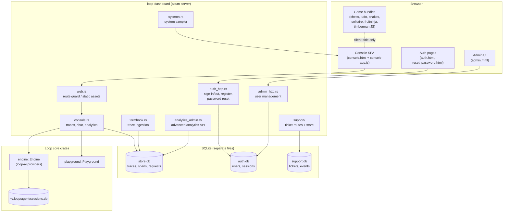
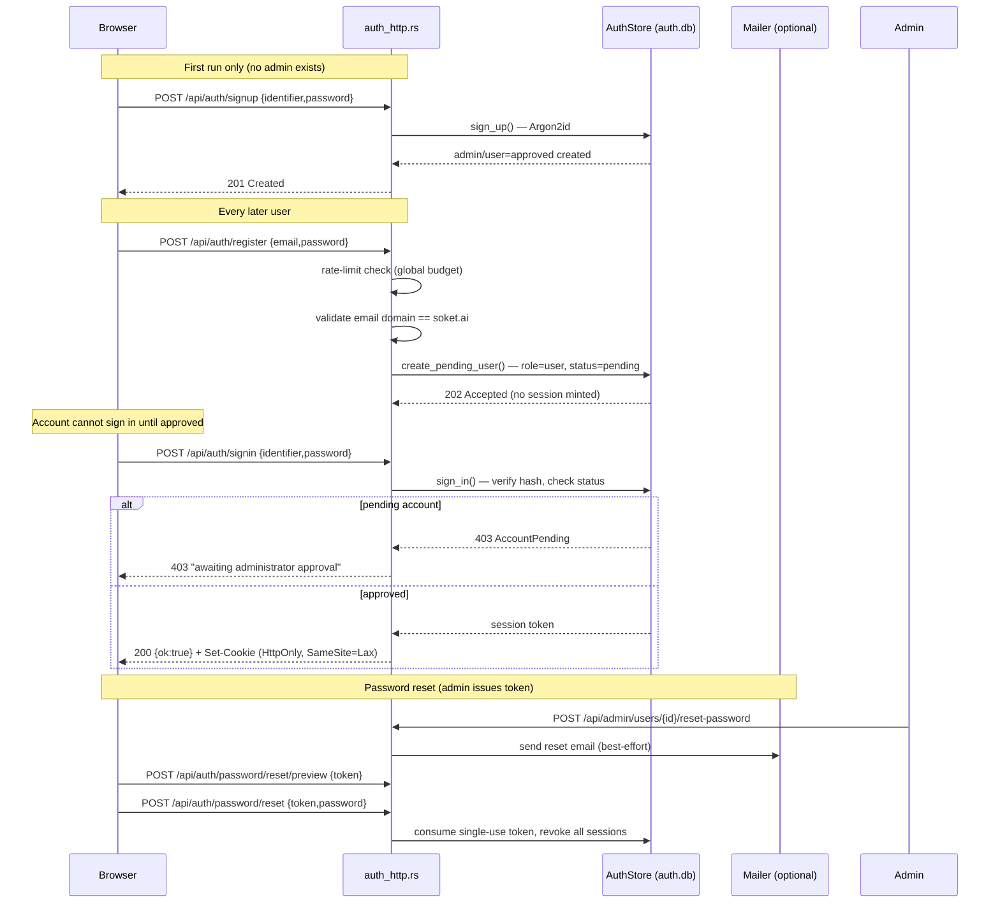
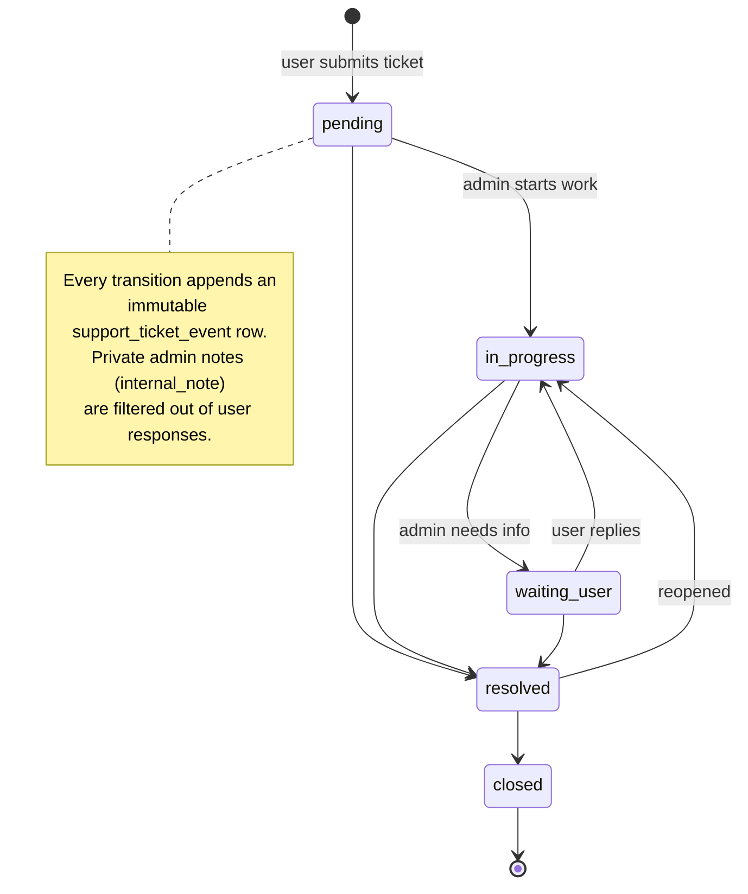

# Loop — Agent Harness & Data Operations Console

**Live deployment:** <https://loopstation.growthon.online/>

[](https://github.com/soketlabs/loop/actions/workflows/ci.yml)
[](https://github.com/soketlabs/loop/releases/latest)
[](LICENSE)
[](https://loop.soket.ai/)

Loop is an open-source Rust agent harness by [**Soket AI**](https://soket.ai) — an agent loop with tool use, sessions, sandboxing and a unified LLM provider API — plus a self-hosted **dashboard** crate (`loop-dashboard`) that ships an authenticated multi-user web console: trace observability, system monitoring, an inference playground, data-pipeline workspaces, internal evaluation tooling and a set of integrated games.

Docs: <https://loop.soket.ai/> · Repo: <https://github.com/soketlabs/loop>

---

## Table of contents

1. [Status & maturity](#status--maturity)
2. [Feature status legend](#feature-status-legend)
3. [Features](#features)
4. [Architecture](#architecture)
5. [Workspace / crates](#workspace--crates)
6. [The dashboard application](#the-dashboard-application)
7. [Authentication & user management](#authentication--user-management)
8. [Support ticket system](#support-ticket-system)
9. [Games ("Fun Time")](#games-fun-time)
10. [Data operations workspaces](#data-operations-workspaces)
11. [API reference](#api-reference)
12. [Installation](#installation)
13. [Build from source](#build-from-source)
14. [Testing & verification](#testing--verification)
15. [Configuration & environment variables](#configuration--environment-variables)
16. [Deployment](#deployment)
17. [Known limitations & roadmap](#known-limitations--roadmap)
18. [Contributing & license](#contributing--license)

---

## Status & maturity

Loop is a **developer preview (alpha)**. Settings, session files, CLI flags and the
dashboard's HTTP surface can change without notice before 1.0. Report problems in
[GitHub Issues](https://github.com/soketlabs/loop/issues).

This README describes the code **as it exists in this repository**, including the
local working tree. Where a capability is only partially wired up, or exists as a
library module without a user-facing flow, that is called out explicitly rather
than advertised as a feature.

---

## Feature status legend

| Marker | Meaning |
|--------|---------|
| ✅ **Implemented** | Wired end-to-end (HTTP route → handler → store → UI) and covered by tests where applicable. |
| 🟡 **Partial** | Core path works but has gaps (no UI consumer, subset of functionality, or admin-only). |
| 🔬 **Library-only** | Code exists as a reusable module but is **not wired into any HTTP route or UI**. Not a user-facing feature. |
| ⚪ **Planned** | Referenced in code comments/design notes as a future phase; no implementation yet. |

---

## Features

### Agent core (crates outside `loop-dashboard`)

* ✅ Agent loop with tool execution and event streaming (`loop-agent`)
* ✅ Unified LLM API with provider collections, auth resolution, token/cost tracking and mid-session model hand-off (`loop-ai`)
* ✅ Interactive `loop` TUI built with ratatui (`loop-cli`), including an embedded `/dashboard` command
* ✅ MCP client + server (`loop-mcp`)
* ✅ Multi-agent orchestration: planner, workflow, scheduler, memory (`loop-orchestration`)
* ✅ OpenTelemetry tracing exported to Langfuse over OTLP/HTTP (`loop-telemetry`)
* ✅ Run any Agent Client Protocol agent (Codex, Claude, Gemini, …) as a backend (`loop-acp`)
* ✅ Verified updates, rollback and program removal (`loop-update`)
* ✅ GPUI desktop application shell (`loop-desktop`, not in default workspace members)
* ✅ Versioned event model shared by every backend and surface (`loop-protocol`)

### Dashboard application (`crates/loop-dashboard`)

* ✅ Local read-only observability dashboard for Loop session traces
* ✅ Real-time system monitor (CPU, memory, disk, GPU, battery, uptime) with history
* ✅ Inference console / playground backed by Loop's real engine configuration
* ✅ Cookie-based authentication with Argon2id password hashing and approval-gated registration
* ✅ Admin console: user approvals, role changes, suspension, password resets, activity logs
* ✅ Support ticket system with attachments, replies, status workflow and private admin notes
* ✅ Analytics computed from persisted traces (nearest-rank percentiles, never averages)
* 🟡 Advanced admin analytics API (`/api/admin/analytics/*`) — implemented and tested server-side, **no UI consumer yet**
* ✅ Six integrated games (see [Games](#games-fun-time))
* ✅ SFT DataTrove, Pretraining DataTrove and Internal Evaluation workspaces
* 🔬 OTP email challenge modules (`auth_otp`, `auth_email`, parts of `mail`) — see [OTP caveat](#critical-caveat-otp-email-verification)

---

## Architecture

### System overview



### Authentication flow



### Support ticket lifecycle



---

## Workspace / crates

| Crate | Path | Role |
|-------|------|------|
| **loop-ai** | [`crates/loop-ai`](crates/loop-ai) | Unified LLM API, Soket provider (`/v1/models` refresh), OpenAI-compat + faux |
| **loop-agent** | [`crates/loop-agent`](crates/loop-agent) | Agent loop, AgentHarness, tools, sessions, sandbox, skills |
| **loop-cli** | [`crates/loop-cli`](crates/loop-cli) | Interactive `loop` TUI (ratatui), embeds the dashboard via `/dashboard` |
| **loop-dashboard** | [`crates/loop-dashboard`](crates/loop-dashboard) | Axum web server: traces, system monitor, console, auth, admin, support, games |
| **loop-orchestration** | [`crates/loop-orchestration`](crates/loop-orchestration) | Planner, workflow, scheduler, memory |
| **loop-mcp** | [`crates/loop-mcp`](crates/loop-mcp) | MCP client and server |
| **loop-telemetry** | [`crates/loop-telemetry`](crates/loop-telemetry) | OpenTelemetry → Langfuse (OTLP/HTTP) |
| **loop-app-core** | [`crates/loop-app-core`](crates/loop-app-core) | Shared bootstrap, config, runtime wiring |
| **loop-test-support** | [`crates/loop-test-support`](crates/loop-test-support) | Test helpers (dev-dependency only) |
| **loop-update** | [`crates/ops/loop-update`](crates/ops/loop-update) | Release checks, verified updates, rollback, uninstall |
| **loop-protocol** | [`crates/core/loop-protocol`](crates/core/loop-protocol) | Versioned event model + backend interface |
| **loop-acp** | [`crates/extend/loop-acp`](crates/extend/loop-acp) | Run any ACP agent as a Loop backend |
| **loop-desktop** | [`crates/loop-desktop`](crates/loop-desktop) | GPUI desktop application (non-default member) |

---

## The dashboard application

Run standalone:

```bash
cargo run -p loop-dashboard            # binds 127.0.0.1:4173, auth enabled
```

Or from inside the `loop` TUI: `/dashboard` (start/open), `/dashboard off` (stop),
`/dashboard status`. The TUI reports three surfaces:

```
traces  : http://127.0.0.1:<port>/
system  : http://127.0.0.1:<port>/system
console : http://127.0.0.1:<port>/console
```

Key CLI flags (see `cargo run -p loop-dashboard -- --help`):

| Flag | Default | Purpose |
|------|---------|---------|
| `--host` | `127.0.0.1` | Bind address; non-loopback requires `--allow-lan` |
| `--port` | `4173` | Listen port |
| `--db` | `~/.loop/agent/sessions.db` | Sessions database to observe |
| `--console-db` | `~/.loop/dashboard/store.db` | Dashboard's own store (traces/requests/conversations) |
| `--demo` | off | Serve clearly-labeled synthetic traces (never mixed with real data) |
| `--sys-demo` | off | Synthetic system metrics |
| `--sys-interval-ms` | `2000` | Sampler interval, 500–60000 ms |
| `--no-auth` | off | Disable authentication entirely (historical open-access mode) |
| `--allow-lan` | off | Permit binding a non-loopback address |

Surfaces served:

* `/` — trace observatory (sessions, spans, requests, latency, tokens, cost)
* `/system` — live system monitor
* `/console` — the main application shell (workspaces, chat, analytics, games)
* `/signin`, `/register`, `/reset-password` — authentication pages
* `/admin` — administrator console (users, approvals, tickets, analytics)

---

## Authentication & user management

### What is implemented

* ✅ **Argon2id** password hashing with fresh random salts; all hashing runs on the
  blocking pool so async workers never stall.
* ✅ **Cookie sessions**: `HttpOnly`, `SameSite=Lax`, `Path=/`, bounded `Max-Age`.
  The `Secure` flag is *not* set because the server binds loopback by default; a
  TLS-terminating reverse proxy is expected in front of any public deployment.
* ✅ **First-run administrator bootstrap** via `POST /api/auth/signup` — exactly one
  administrator can ever exist (enforced by a partial unique index on `role='admin'`;
  later calls return `409 CONFLICT` and write nothing).
* ✅ **Approval-gated registration**: `POST /api/auth/register` creates accounts with
  `role=user, status=pending`. No session is minted; sign-in returns `403
  AccountPending` until an administrator approves. The request body deliberately
  ignores any client-supplied `role`/`status`/`isAdmin` fields.
* ✅ **Registration policy**: global rate limiting checked before validation or
  hashing; email must be exactly `@soket.ai` (lookalikes such as `soket.ai.example.com`,
  `example.soket.ai`, trailing dots and IDN homoglyphs are rejected); password 8–256 chars.
* ✅ **Sign-out** invalidates the session server-side and clears the cookie.
* ✅ **Password reset**: admins issue a single-use, expiring, attempt-bounded token;
  the public side offers `POST /api/auth/password/reset/preview` (non-consuming
  validity check) and `POST /api/auth/password/reset` (consumes token, sets new
  Argon2id hash, revokes every existing session for the account).
* ✅ **Dino Runner mini-game** on the sign-in page after three consecutive *credential*
  failures (HTTP 401 only). Purely cosmetic: the counter is page-scoped, driven only
  by real server responses, stores no secrets, and the game can never authenticate
  anyone or unhide a protected route.
* ✅ **Admin user management** (`admin_http.rs`, all behind `require_admin`):
  list/filter users, view detail, approve/reject pending accounts, change roles,
  suspend/reactivate, force password reset, revoke sessions, per-user activity log,
  delete account (refuses self-delete and deleting the last administrator).

### Critical caveat — OTP email verification

> **OTP is NOT a user-facing feature in this codebase.**

The repository contains substantial OTP infrastructure:

* `crates/loop-dashboard/src/auth_otp.rs` — an `OtpStore` with challenge issuing,
  attempt bounding and expiry
* `crates/loop-dashboard/src/auth_email.rs` — strict email normalization/validation
  (`normalize_registration_email`), whose doc comment says *"Proving that the person
  controls the mailbox is the OTP challenge's job"*
* `crates/loop-dashboard/src/mail.rs` — a `MailSender` abstraction with a Resend-style
  provider (`LOOP_EMAIL_PROVIDER` / `LOOP_EMAIL_API_KEY` / `LOOP_EMAIL_FROM`)

However, **none of this is wired into the HTTP authentication flow**:

* `grep` across `src/api.rs`, `src/auth_http.rs`, `src/admin_http.rs`, `src/web.rs`
  finds **zero** references to OTP or `OtpStore`.
* The only reference to `auth_otp` outside its own file is the module declaration
  in `lib.rs` (`pub mod auth_otp;`).
* The `register` handler's own documentation states: *"Email delivery is intentionally
  not part of this flow: registration succeeds without Resend credentials or OTP
  verification (**those arrive in a later phase**)."*

Consequences, stated plainly:

* Registration does **not** send a verification email and does **not** require OTP.
* Sign-in is username/email + password only — no second factor.
* Password-reset emails are best-effort; if mail is unconfigured the admin-issued
  token flow still works through the token itself.
* Do not document, advertise or rely on email verification, OTP codes or 2FA as a
  current capability. Treat `auth_otp`/`auth_email`/`mail` as 🔬 **library-only**
  groundwork for a future phase.

---

## Support ticket system

Implemented in `crates/loop-dashboard/src/support/` (`mod.rs` for routes, `store.rs`
for persistence), mounted only when authentication is enabled (`--no-auth` disables it).

Design properties (from the module docs, enforced in code):

* **One header button, two experiences** — normal users get "Raise a Request"
  (submit + track their own tickets); administrators get "Support Management"
  (all tickets, replies, status changes, private notes). The server decides which;
  frontend role hints are never trusted.
* **Per-request authorization** — every handler re-resolves the caller's current role
  from the session store, mirroring `require_admin`.
* **Ownership scoping** — a normal user's list/detail requests are forcibly scoped to
  their own `user_id`; probing another user's ticket id yields `404` (not `403`) so ids
  cannot be enumerated.
* **Private notes never leak** — stored as `internal_note` events and filtered out of
  every user-facing response by construction.
* **Email is best-effort after commit** — notification failures are logged and reported
  but never roll back or lose the submission.

Vocabulary and bounds:

| Field | Allowed values / limits |
|-------|--------------------------|
| Category | `technical_issue`, `bug_report`, `login_problem`, `performance_issue`, `data_pipeline`, `model_evaluation`, `feature_request`, `general_inquiry`, `other` |
| Priority | `low`, `medium`, `high`, `critical` |
| Status | `pending`, `in_progress`, `waiting_user`, `resolved`, `closed` |
| Subject | ≤ 200 chars |
| Description | ≤ 20 000 chars |
| Attachments | ≤ 5 per ticket, ≤ 5 MiB each (decoded), filename ≤ 200 chars, content-type allow-list enforced before storage |
| Submit rate limit | per user, one-hour window |
| Body limits | submit ≈ 10.5 MB (base64 headroom); admin actions 32 KB |

History is append-only: every status change or reply inserts a `support_ticket_event`
row, so ticket history is a log that cannot be rewritten after the fact. Optimistic
concurrency guards produce `409 Conflict` if a row changed between read and write.

---

## Games ("Fun Time")

All games are **client-side only** — pure HTML/CSS/JS served as static assets from
`crates/loop-dashboard/src/assets/`, mounted under the console's `#funtime` routes.
No game touches the network, the databases or any authenticated endpoint.

| Game | Route | Status | Controls & notes |
|------|-------|--------|------------------|
| **Space Invaders** | `#funtime/si` | ✅ | Ship fires automatically. Move: ←/→ or A/D, or drag on the field (touch). P pauses, R restarts. HUD: score, high, wave, lives (ship glyphs). Phase-2 power-ups with duration chips; per-game audio settings (music/SFX volume + mute) mirrored in overlay and inline. |
| **Hack Terminal** | `#funtime/ht` | ✅ | Four timed security locks: (1) Terminal Access — deduce a 4-digit code from clues; (2) Crack the Sequence — arithmetic/rule sequences; (3) Decode the Signal — Caesar cipher with documented shift; (4) Firewall Bypass — order six nodes using relational clues. Hints and full solutions available; fully simulated, no real system is touched. Own audio context. |
| **Cyber Rush** (street racing) | `#funtime/cr` | ✅ | Segment-based pseudo-3D racer on Canvas 2D (16-bit style). Multiple cars with distinct accel/top-speed/steering/grip/drift/nitro tuning. Nitro and drift mechanics with tyre audio. Steer with arrows/A-D; Space for nitro. |
| **Chess** | `#funtime/ch` | ✅ | Negamax + alpha-beta search with quiescence. Difficulty: easy (depth 1, ~160 ms, may pick within 90 cp of best), medium (depth 2, ~380 ms, 35 cp), hard (depth 3, ~850 ms, always best), expert (depth 4+, ~1500 ms, deeper via time budget). |
| **Ludo** | `#funtime/lu` | ✅ | 2–4 players, any mix of human/AI seats with selectable AI levels. Lobby shows seat colour, human/AI + level per active seat. Responsive down to 320 px; landscape-phone layout collapses the seat strip. |
| **Snakes & Ladders** | `#funtime/sn` | ✅ | Human vs computer multiplayer; side rail holds dice, players and event log. Autoplay policy unlocks audio context on first human interaction; AI turns pause ~700 ms before rolling. Mobile layout stacks the rail below the board with two-per-row player chips. |
| **Solitaire** | `#funtime/so` | ✅ | Klondike with score/moves/time stats, unlimited **undo** and a **hint** system that pulses both the source card and destination slot (disabled under reduced-motion). |
| **Fruit Ninja** | `#funtime/fn` | ✅ | Swipe-slicing arcade game (`fruitninja-game.js`); see `tests/fruitninja_ui.rs`. |
| **Timberman** | `#funtime/tm` | ✅ | Timing/reflex tree-chopping game (`timberman-game.js`); upgrade path covered by `scripts/verify_timberman_upgrade.py` and `tests/timberman_ui.rs`. |

Every game follows the same lifecycle contract: one state object, an epoch guard that
invalidates stale animation loops, listeners registered through a per-game `xxOn()`
helper, and teardown on any route change — so leaving a view stops its timers and audio.

---

## Data operations workspaces

Accessible from the console sidebar:

* **SFT DataTrove** (`#sft`) — supervised fine-tuning data pipeline map: input
  (OpenAI chat JSONL) → Layer 1 deterministic rule checks → Layer 2 per-token LM audit
  → Layer 3a embeddings (near-duplicates & conflicts) → Layer 3b optional LLM-judge
  rubric → scoring & routing into `high/<name>.jsonl` (training-ready),
  `low/<name>.jsonl` (dropped, kept with reasons) and `scores.jsonl` (per-row flags,
  score and reasons).
* **Pretraining DataTrove** (`#pretrain`) — pretraining corpus pipeline workspace.
* **Internal Evaluation** (`#eval`) — sections: Overview, Question Bank, Datasets,
  Benchmarks (plus deep-linkable sub-sections).
* **EKA Checkpoints** — checkpoint-by-level view; the original reference artifact is
  preserved at `docs/original/EKA_Checkpoints_by_Level_original.html`.

---

## API reference

All endpoints are JSON unless noted. Errors are shaped `{ "error": "..." }` with
generic messages that never leak internals, hashes, tokens or numeric account ids.

### Public authentication

| Method & path | Success | Failure |
|---------------|---------|---------|
| `GET /api/auth/status` | `{ firstRun, signedIn, identifier }` | — |
| `POST /api/auth/signin` `{identifier, password}` | `200 {ok:true}` + `Set-Cookie` | `401` bad credentials · `403` pending account · `429` rate limited |
| `POST /api/auth/register` `{email, password}` | `202 {ok:true, status:"pending", message}` | `400` invalid input · `409` conflict · `429` rate limited |
| `POST /api/auth/signup` `{identifier, password}` | `201 {ok:true}` — **first-run admin bootstrap only**; `409` once an admin exists | `400` |
| `POST /api/auth/signout` | `200 {ok:true}` + clear-cookie | — |
| `POST /api/auth/password/reset/preview` `{token}` | `200 {valid: bool}` (non-consuming, boolean-only answer) | — |
| `POST /api/auth/password/reset` `{token, password}` | `200` | `400` missing password · `4xx` invalid/expired/consumed token |

The client (`auth.html`) documents and enforces these contracts, and never falls back
to `/signup` for ordinary registration — that would be a privilege bug.

### Admin (session + `role=admin` required; `--no-auth` owner retains access)

| Method & path | Purpose |
|---------------|---------|
| `GET /api/admin/users/pending` | Pending-approval queue |
| `GET /api/admin/users` (+ query) | Filtered user list |
| `GET /api/admin/users/{id}` | User detail |
| `POST /api/admin/users/{id}/approve` | `200 {ok:true,status:"approved"}` |
| `POST /api/admin/users/{id}/reject` | `200 {ok:true,status:"rejected"}` |
| `POST /api/admin/users/{id}/role` | Change role |
| `POST /api/admin/users/{id}/suspend` | Suspend account |
| `POST /api/admin/users/{id}/reactivate` | Restore account |
| `POST /api/admin/users/{id}/reset-password` | Issue reset token/email |
| `POST /api/admin/users/{id}/revoke-sessions` | Invalidate all sessions |
| `GET /api/admin/users/{id}/activity?page=&perPage=25` | Activity log |
| `DELETE /api/admin/users/{id}` | Delete (refuses self / last admin) |

### Advanced analytics (admin-only, 🟡 no UI consumer yet)

`GET /api/admin/analytics/{models,providers,tokens,latency,tools,errors,sessions,cost,…,compare}`
— filters: `fromMs`, `toMs`, `model`, `provider`, `status` (comma-separated),
`operation`. Computed **from persisted traces only**; NULL columns are reported as
`null` / "Not reported", never as zero. Covered by 16 in-module tests.

### Support tickets

User-scoped: submit a ticket (with base64 attachments), list and read your own
tickets, reply. Admin: list all (filterable), reply, change status, add private
internal notes. Ownership violations return `404`; concurrent edits return `409`.

### Other

* `GET /api/analytics` — console analytics (totals, byStatus, latency/ttft percentile
  blocks, token sums, per-model usage) consumed by the Analytics view.
* Trace ingestion endpoint in `termhook.rs` — bearer-token authenticated, body-size
  capped, secret-scrubbing, caps oversized output, recovers late completions.

---

## Installation

### Prebuilt binary (macOS, Linux, WSL)

```bash
curl -fsSL https://loop.soket.ai/install | bash
```

Windows (native PowerShell): use `install.ps1` from this repository.

The installer fetches the latest release from
<https://github.com/soketlabs/loop/releases>, verifies it, and installs to
`$HOME/.loop/bin` by default (override with `LOOP_INSTALL_DIR`). Options:

```bash
./install.sh --version 0.3.2     # pin a version
./install.sh --help              # full option list
```

---

## Build from source

Requires Rust **1.88+** (see `rust-version` in `Cargo.toml`).

```bash
git clone https://github.com/soketlabs/loop.git
cd loop

cargo build                       # default members (CLI + core crates)
cargo build --workspace           # everything, including loop-dashboard & loop-desktop
cargo build -p loop-dashboard     # just the dashboard server
cargo build --release             # optimized
```

Verified in this working tree: `cargo build -p loop-dashboard` completes cleanly.

---

## Testing & verification

### Unit and integration tests

```bash
cargo test -p loop-dashboard          # library + integration tests
cargo test --workspace                # whole workspace
cargo test -p loop-dashboard --lib    # library tests only
```

**Honest status of the latest run in this working tree** (`cargo test -p loop-dashboard --offline`):

```
Running unittests src/lib.rs (target/debug/deps/loop_dashboard-...)
test result: FAILED. 471 passed; 1 failed; 0 ignored; 0 measured; 0 filtered out
```

* **471 passed, 1 failed.** The failing test is
  `auth::tests::delete_account_refuses_self_and_last_admin`
  (`crates/loop-dashboard/src/auth.rs:4027`):
  `assertion failed: matches!(s.delete_account(admin, admin), Err(AccountError::Validation(_)))`
  — i.e. deleting the *last administrator's own account* was expected to be refused
  but currently is not. This is a **real, unresolved defect** in the working tree, not
  a flake; treat it as a known issue until fixed.
* Because the library suite aborts on that failure, the integration test binaries
  (`tests/*.rs` — `admin_ui`, `auth_ui`, `cyber_rush_ui`, `eka_checkpoints_ui`,
  `eval_workspaces_ui`, `fruitninja_ui`, `hack_terminal_ui`, `landing_flow`,
  `ludo_ui`, `sft_board_ui`, `sft_pipeline_map_ui`, `snakes_ui`, `solitaire_ui`,
  `space_invaders_ui`, `support_ui`, `timberman_ui`) **did not run to completion in
  this session** and are reported here as unverified. Individual suites can be run
  directly, e.g. `cargo test -p loop-dashboard --test support_ui`.

### Python verification scripts

`scripts/` contains 27 Playwright-style browser verification scripts used during
feature development (mostly headless-UI walkthroughs of the games and workspaces):

```bash
python3 scripts/verify_snakes.py
python3 scripts/verify_ludo.py
python3 scripts/verify_cyber_rush.py
python3 scripts/verify_eval_workspaces.py
python3 scripts/verify_hack_terminal.py
python3 scripts/verify_timberman_upgrade.py   # …and 22 more; see scripts/
```

Also present: `scripts/audit_ludo_simulations.py` and `scripts/benchmark_ludo_ai.py`
(AI-quality auditing/benchmarking for the Ludo bots). These scripts are **not** part
of CI and were **not executed** while preparing this README.

---

## Configuration & environment variables

### Dashboard

| Variable | Purpose |
|----------|---------|
| `LOOP_DASHBOARD_DIR` | Override the dashboard's data directory |
| `LOOP_SUPPORT_EMAIL` | Destination address for new-ticket notifications to administrators |
| `LOOP_EMAIL_PROVIDER` | Email provider selection (e.g. Resend) — 🔬 mail module only, see OTP caveat |
| `LOOP_EMAIL_API_KEY` | Provider API key — 🔬 mail module only |
| `LOOP_EMAIL_FROM` | Verified From identity — 🔬 mail module only |

### CLI / agent

| Variable | Purpose |
|----------|---------|
| `LOOP_AGENT_DIR` | Override the agent data directory (default `~/.loop/agent`) |
| `LOOP_CODING_AGENT_DIR` | Coding-agent data directory override |
| `LOOP_EVAL_ROOT` | Root directory for evaluation datasets/benchmarks |
| `SOKET_PIPELINE_ROOT` | Root directory for DataTrove pipelines |
| `LOOP_DEBUG` | Enable debug logging |
| `LOOP_NO_UPDATE_CHECK` | Skip the release update check |
| `LOOP_TERM_DISABLE` | Disable terminal integration hooks |

Databases are git-ignored (`*.db`, `*.sqlite*`) along with `.env*` (except
`.env.example`), secrets (`*.pem`, `*.key`) and scratch screenshot directories.

---

## Deployment

### Live instance

The deployed application is served at **<https://loopstation.growthon.online/>**
and currently presents the Loop sign-in page ("unified AI development & data
operations"), with a "Request access" link to the registration page and the footer
"Local instance · accounts never leave this machine".

### Running behind a reverse proxy

The dashboard binds `127.0.0.1` by default and refuses non-loopback binds unless
`--allow-lan` is passed. For a public deployment:

1. Run the server on loopback, e.g. `cargo run --release -p loop-dashboard -- --port 4173`.
2. Terminate TLS at a reverse proxy (nginx, Caddy, Cloudflare Tunnel, …) and forward
   to `127.0.0.1:4173`.
3. Note that session cookies are emitted **without** the `Secure` attribute because
   the origin is plain HTTP on loopback; the proxy must enforce HTTPS end-to-end.
4. On first run, create the single administrator via the sign-up form shown when
   `GET /api/auth/status` reports `firstRun: true`; afterwards all users self-register
   into the pending-approval queue.
5. Configure `LOOP_SUPPORT_EMAIL` (and, in a future phase, the `LOOP_EMAIL_*`
   variables) if email notifications are wanted.

> ⚠️ No reverse-proxy, container, systemd or Cloudflare configuration ships in this
> repository — the public URL above is operated outside the repo. Treat deployment
> tooling as environment-specific and not provided here.

---

## Known limitations & roadmap

**Confirmed limitations (verified in code):**

1. **No OTP / email verification** — library modules exist (`auth_otp`, `auth_email`,
   `mail`) but are not wired into any HTTP route. Registration requires no email
   proof; there is no second factor. *(🔬 library-only → ⚪ planned)*
2. **Single administrator** — by design; the partial unique index permits exactly one
   `role='admin'` row.
3. **Registration restricted to `@soket.ai`** — exact byte-equality domain match for
   new registrations (the first-run admin may use a grandfathered address).
4. **Advanced admin analytics has no UI** — `/api/admin/analytics/*` is implemented
   and tested but nothing in `console-app.js`, `admin.html` or any asset calls it.
5. **Cookies lack `Secure`** — safe on loopback; public deployments must rely on a
   TLS-terminating proxy.
6. **One known failing test** — `delete_account_refuses_self_and_last_admin` (see
   [Testing](#testing--verification)).
7. **Games are client-side only** — scores (including "high" scores) are not persisted
   server-side beyond local storage; no multiplayer.

**Roadmap signals found in code comments (⚪ planned, not implemented):**

* OTP email challenge wired into registration and/or sign-in ("those arrive in a
  later phase").
* Broader email delivery usage beyond best-effort support/reset notifications.

---

## Contributing & license

* **License:** Apache-2.0 — see [LICENSE](LICENSE).
* **Issues:** <https://github.com/soketlabs/loop/issues>
* **Docs:** <https://loop.soket.ai/>
* **Releases:** <https://github.com/soketlabs/loop/releases>

Loop is a developer preview: expect breaking changes to settings, session files,
CLI flags and the dashboard HTTP surface before 1.0.
